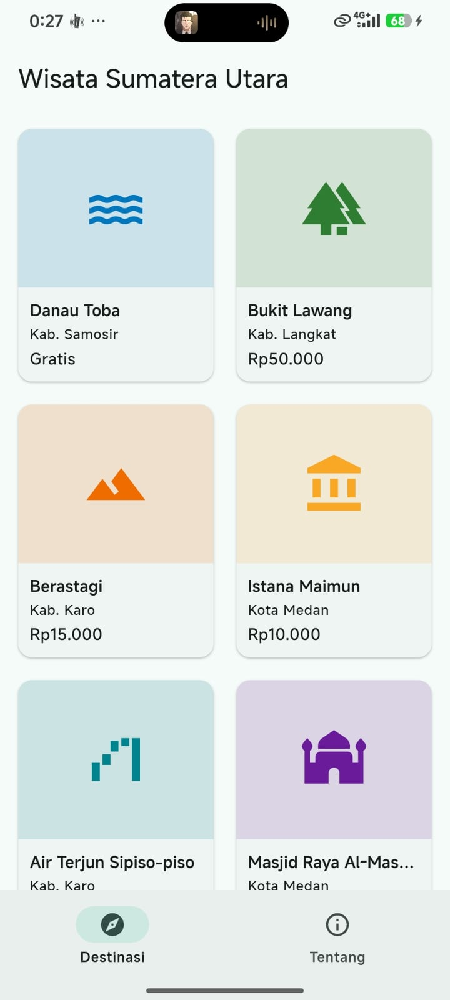
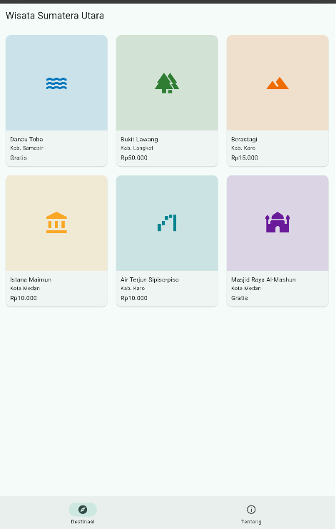
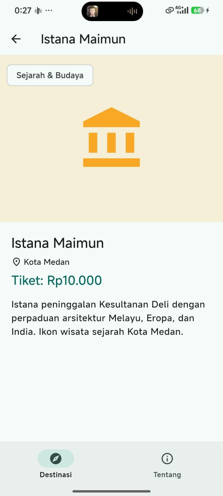
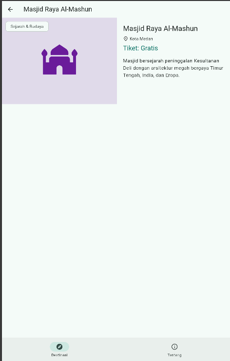
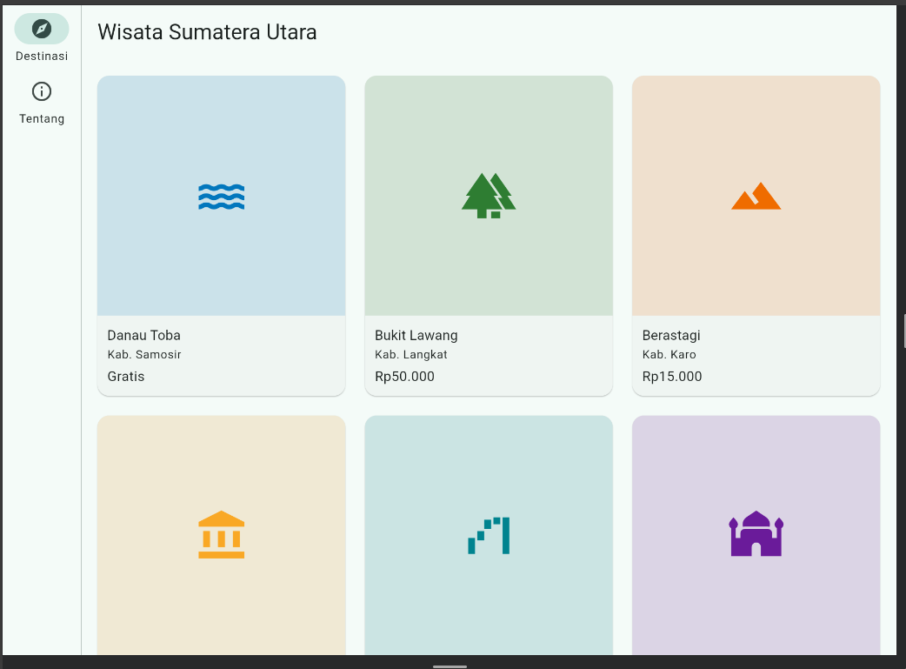

# Wisata Sumatera Utara (Tugas Rutin 6 - Pemrograman Mobile)

## Identitas
- Nama: Adinda Soleha
- NIM: 4242550001
- Kelas: PSIK 24D
- Mata Kuliah: Pemrograman Mobile

## Tangkapan Layar
| | Ponsel | Tablet |
|---|---|---|
| Daftar |  |  | 
| Detail |  |  |
| Daftar (layar lebar 1280 × 800, NavigationRail + grid 4 kolom) |  |


## Keputusan Responsif

Saya memakai tiga batas lebar dalam aplikasi ini. Grid pada halaman daftar memakai LayoutBuilder dengan batas 600 dan 900 dp, sehingga jumlah kolom menjadi 2 (ponsel), 3 (tablet), dan 4 (layar lebar). Saya memilih LayoutBuilder karena grid hanya perlu mengetahui lebar ruang yang diberikan parent, bukan lebar seluruh layar; ketika NavigationRail tampil, ruang grid memang lebih sempit daripada layar. Halaman detail juga memakai LayoutBuilder dengan batas 700 dp: di bawah batas itu gambar dan informasi tersusun vertikal dalam ListView, sedangkan di atasnya keduanya berdampingan dalam Row dengan Expanded. Label kategori diletakkan di atas gambar menggunakan Stack dan Positioned. Kerangka navigasi memakai MediaQuery.sizeOf karena keputusannya berlaku untuk seluruh aplikasi: NavigationBar untuk lebar kurang dari 840 dp dan NavigationRail untuk 840 dp ke atas, mengikuti window size class Material 3. Karena itu, pada tablet 768 × 1024 dp grid sudah 3 kolom dan detail berdampingan, tetapi navigasi masih NavigationBar; NavigationRail dan grid 4 kolom baru muncul pada layar lebar 1280 × 800 dp. Overflow dicegah dengan maxLines, ellipsis, dan Expanded. Pengujian dilakukan pada ponsel, tablet 768 × 1024 dp, dan layar lebar 1280 × 800 dp.

## Pernyataan Penggunaan AI

Kerangka kode aplikasi ini (struktur proyek, model data, konfigurasi go_router, tata letak responsif, dan draf README) dibuat dengan bantuan Claude (Anthropic). Saya mempelajari kode tersebut, menjalankannya di emulator, memeriksa tampilannya pada ukuran layar ponsel dan tablet, serta menyesuaikan data destinasi dan isi README. Saya bertanggung jawab atas seluruh isi repository ini.

## Menjalankan
```
flutter pub get
flutter run
flutter test
flutter analyze
```
